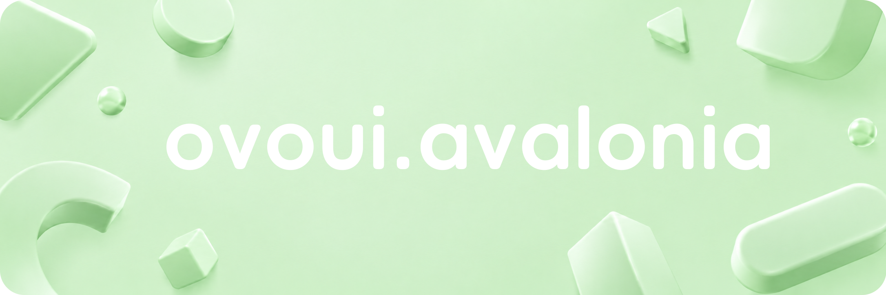

<p align="center">
  <a href="https://ifdian.net/a/tiouo">
    
  </a>
  <a href="https://github.com/tiouoo/ovoui.avalonia">
    
  </a>
</p>

<p align="start">
  <a href="https://github.com/tiouoo/ovoui.avalonia/actions/workflows/publish-nuget.yml"></a>
  <a href="https://www.nuget.org/packages/OvoUi"></a>
  <a href="https://www.nuget.org/packages/OvoUi"></a>
  <a href="https://github.com/tiouoo/ovoui.avalonia/stargazers"></a>
  <a href="LICENSE"></a>
  
  
</p>

---

## 为 Avalonia 应用提供一致、现代的界面体验

OvoUi 是一个面向 [Avalonia](https://avaloniaui.net/) 的跨平台控件库与主题。它在统一原生控件视觉风格的基础上，补充了导航、数据录入、反馈、布局和窗口等常用组件，并提供深浅色主题、主题色与中英文切换能力。

## 功能

### 控件与主题

- 为 Avalonia 基础控件提供统一的浅色与深色样式
- 提供导航菜单、面包屑、分页、时间线、锚点等导航与信息展示控件
- 提供多选下拉框、自动完成、标签输入、验证码、IPv4、路径选择、评分和范围滑块等输入控件
- 提供对话框、抽屉、消息框、通知、Toast、加载状态与确认弹出框等反馈组件
- 提供图片查看、二维码、骨架屏、闪光文本和弹性布局等扩展组件
- 提供自定义窗口、标题栏以及 Windows、macOS 平台集成

### 配套能力

- 支持运行时切换主题色
- 内置简体中文与英文，可接入自定义语言
- 提供适配 OvoUi 的 AvaloniaEdit 代码编辑与语法高亮组件
- 提供可选字体资源与控件示例展示组件
- 示例应用支持 Windows、macOS、Linux、Android、iOS 与浏览器

## 安装

从 NuGet 安装核心包：

```bash
dotnet add package OvoUi
```

按需安装配套包：

| 包 | 用途 |
| --- | --- |
| [`OvoUi`](https://www.nuget.org/packages/OvoUi) | 核心控件与主题 |
| [`OvoUi.Fonts`](https://www.nuget.org/packages/OvoUi.Fonts) | OvoUi 字体资源 |
| [`OvoUi.Platform`](https://www.nuget.org/packages/OvoUi.Platform) | Windows 与 macOS 原生平台集成 |
| [`OvoUi.AvaloniaEdit`](https://www.nuget.org/packages/OvoUi.AvaloniaEdit) | 代码编辑、代码块与语法高亮 |
| [`OvoUi.AvaloniaEdit.Showcase`](https://www.nuget.org/packages/OvoUi.AvaloniaEdit.Showcase) | 控件示例与 AXAML 源码展示 |

也可以从 [Releases](https://github.com/tiouoo/ovoui.avalonia/releases) 下载发布产物。

## 快速开始

在 `App.axaml` 中声明 OvoUi 命名空间并引入主题：

```xml
<Application
    x:Class="YourApp.App"
    xmlns="https://github.com/avaloniaui"
    xmlns:x="http://schemas.microsoft.com/winfx/2006/xaml"
    xmlns:ovo="https://github.com/tiouoo/ovoui.avalonia">
    <Application.Styles>
        <ovo:OvoUiTheme />
    </Application.Styles>
</Application>
```

之后即可在 AXAML 中使用 OvoUi 控件：

```xml
<ovo:OvoWindow
    xmlns="https://github.com/avaloniaui"
    xmlns:x="http://schemas.microsoft.com/winfx/2006/xaml"
    xmlns:ovo="https://github.com/tiouoo/ovoui.avalonia"
    Title="OvoUi Demo">
    <StackPanel Margin="24" Spacing="12">
        <TextBlock FontSize="24" Text="Hello, OvoUi!" />
        <ovo:Rating Value="4" />
        <ovo:QRCode Data="https://github.com/tiouoo/ovoui.avalonia" />
    </StackPanel>
</ovo:OvoWindow>
```

## 主题与语言

可在引入主题时设置语言和主题色：

```xml
<ovo:OvoUiTheme Language="zh_cn" ThemeColor="#1890ff" />
```

当前内置语言：

- `zh_cn`：简体中文
- `en_us`：英文

也可以在运行时切换：

```csharp
using Avalonia.Media;
using OvoUi.Common.Language;
using OvoUi.Common.Theme;

LangManager.SetLanguage(Languages.en_us);
ThemeManager.SetThemeColor(Color.Parse("#52c41a"));
```

如需使用自定义语言，请实现 `ILang`，再通过 `CustomLanguage` 或 `LangManager.SetLanguage(...)` 应用。

## 从源代码运行

需要安装 [.NET 10 SDK](https://dotnet.microsoft.com/download/dotnet/10.0)。

```bash
git clone https://github.com/tiouoo/ovoui.avalonia.git
cd ovoui.avalonia
dotnet restore OvoUi.slnx
dotnet run --project src/Demo/OvoUi.Demo.Desktop/OvoUi.Demo.Desktop.csproj
```

浏览器示例：

```bash
dotnet workload restore src/Demo/OvoUi.Demo.Browser/OvoUi.Demo.Browser.csproj
dotnet run --project src/Demo/OvoUi.Demo.Browser/OvoUi.Demo.Browser.csproj
```

## 项目结构

| 目录 | 内容 |
| --- | --- |
| `src/OvoUi` | 核心控件、主题与公共能力 |
| `src/OvoUi.Fonts` | 字体资源 |
| `src/OvoUi.Platform` | Windows 与 macOS 平台集成 |
| `src/OvoUi.AvaloniaEdit` | AvaloniaEdit 集成 |
| `src/OvoUi.AvaloniaEdit.Showcase` | 控件源码展示组件 |
| `src/Demo` | 桌面、移动端与浏览器示例应用 |

## 致谢

OvoUi 的设计与实现受到了以下优秀开源项目的启发：

- [Avalonia](https://github.com/AvaloniaUI/Avalonia)
- [Semi.Avalonia](https://github.com/irihitech/Semi.Avalonia)
- [Ursa.Avalonia](https://github.com/irihitech/Ursa.Avalonia)
- [SukiUI](https://github.com/kikipoulet/SukiUI)

感谢所有参与反馈、贡献与维护的开发者。
